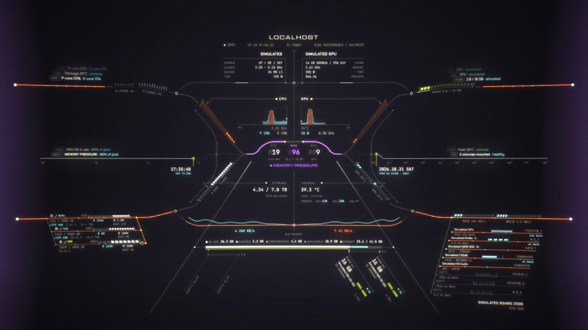

# Telemetry HUD

[English](README.md) · [简体中文](README.zh-CN.md) · 日本語

サイバーパンク風のシステムモニター壁紙です。単体でデスクトップアイコンの後ろに表示することも、[Wallpaper Engine](https://www.wallpaperengine.io/) で使うこともできます。自分の PC のリアルタイムデータを表示します。CPU（P コア / E コアを区別）、GPU、メモリモジュール 1 枚ごと、ドライブ 1 台ごと、ネットワーク、マザーボードのスロット、消費電力に対応しています。ハードウェアの情報は、小さなローカルヘルパープログラムが読み取ります。

## 機能

- **CPU / GPU**：使用率、クロック、温度、消費電力。Intel のハイブリッド CPU では P コアと E コアを別々に表示します。
- **メモリ**：使用中・キャッシュ・圧縮・コミット済み・利用可能。DIMM ごとのカード（容量、速度、メーカー、型番）と空きスロットも表示します。
- **ドライブ**：ドライブごとの読み書き速度、ビジー率、空き容量。NVMe・SATA SSD・HDD はそれぞれ異なる描き方で表示し、ドライブが報告する場合は寿命と通電時間も表示します。
- **マザーボード**：PCIe / M.2 スロットと搭載デバイス、実際のリンク幅と速度。
- **電源**：AC / バッテリー、電源プラン、CPU パッケージ電力、システム全体の電力（ハードウェアが対応している場合）。
- **アラート**：CPU・GPU・メモリの飽和、高温、ディスクのボトルネック、大量のアップロード / ダウンロードを、それぞれ専用の色と効果音で知らせます。
- **偽の数値は出しません**：読み取れない値は **NO SIGNAL** と表示し、数値をでっち上げることはありません。データが戻ると、そのパネルはマウントアニメーションとともに復帰します。
- コンポーネントが順に立ち上がる起動アニメーション、合成効果音、グロー / 走査線 / 画面湾曲のポストエフェクト、4 種類のカラーテーマ。

## インストール

Windows 10/11（x64）が必要です。[`hud-telemetry.exe`](https://github.com/Jannchie/telemetry-hud/releases/latest/download/hud-telemetry.exe) をダウンロードしてダブルクリックすると、使い方を選ぶダイアログが出ます。

- **はい：単体の壁紙**。Wallpaper Engine は不要です。
- **いいえ：ヘルパーのみ**。Wallpaper Engine の壁紙と組み合わせて使います。

どちらの場合も `%LOCALAPPDATA%\TelemetryHUD` に自分自身をコピーし、サインイン時の自動起動を登録して（管理者権限は不要）、そのまま動き始めます。ダウンロードしたファイルは削除して構いません。

exe にはコード署名がないため、初回起動時に Windows SmartScreen の警告が出ることがあります。**詳細情報 → 実行** をクリックしてください。

### 単体の壁紙

HUD はデスクトップアイコンの後ろに、モニターごとに 1 つずつ表示されます。Microsoft Edge WebView2 Runtime を使います（Windows 11 と最新の Windows 10 には標準で入っています）。

- モニター上のウィンドウが最大化または全画面（ゲームなど）になっている間は、そのモニターの描画を止めます。見えていないときはリソースを使いません。
- タスクトレイのアイコンから設定・一時停止・終了ができます。アイコンをダブルクリックしても設定が開きます。
- 音が出るのはプライマリモニターの HUD だけです。
- アイコンの後ろにあっても、視差効果はマウスに追従します。

Wallpaper Engine でもこの壁紙を表示している場合は、二重に描画されるので先に止めてください。

### Wallpaper Engine

インストールのダイアログで **いいえ** を選び、ヘルパーだけをインストールします。次に同じリリースから `telemetry-hud-wallpaper-*.zip` をダウンロードし、
`…\steamapps\common\wallpaper_engine\projects\myprojects\` に展開します。インストール済みの壁紙に **Telemetry HUD** が表示されます。

ヘルパーがなくても Wallpaper Engine の壁紙は動きますが、すべてのパネルが NO SIGNAL になります。

あとから使い方を切り替えるには、`hud-telemetry.exe --install --wallpaper`（単体の壁紙）または `hud-telemetry.exe --install --background`（ヘルパーのみ）を実行します。

### オプション：CPU 温度

Windows は CPU 温度を通常のプログラムに公開していません。表示したい場合は次の手順を行います。

1. [LibreHardwareMonitor](https://github.com/LibreHardwareMonitor/LibreHardwareMonitor/releases) をダウンロードし、**管理者として**実行します（CPU センサーの読み取りには管理者権限が必要です）。
2. **Options → Remote Web Server → Run** を有効にします（ポート 8085）。
3. 再起動後も動かしておくには、**Options → Run On Windows Startup** と **Start Minimized** も有効にします。

ヘルパーは 15 秒ほどで自動的に接続します。Windows が CPU パッケージ電力を公開していない環境では、この値も LibreHardwareMonitor から読み取ります。GPU の温度と消費電力には NVIDIA ドライバーが必要です。

## 設定

- **Wallpaper Engine のプロパティ**：テーマ、ポストエフェクト、湾曲、グロー、走査線、音量、環境ノイズ。
- **壁紙内のコントロールパネル**：右上のボタンで開きます。変更はすぐに反映されて保存されますが、壁紙を読み込むたびに Wallpaper Engine のプロパティの値で上書きされます。
- **単体の壁紙**：タスクトレイのアイコンを右クリックして **設定** を選ぶと、コントロールパネルが別ウィンドウで開きます。変更はすぐにデスクトップへ反映されます。

## アンインストール

`hud-telemetry.exe` をもう一度ダブルクリックし、**はい** を選びます。ヘルパーまたは単体の壁紙を停止し、自動起動の登録とインストール済みのファイルを削除します。単体の壁紙の設定も一緒に削除されます。

## プライバシー

ヘルパーは `127.0.0.1:27182` でのみ待ち受け、外部への通信は一切行いません。壁紙もこのローカルアドレスからのみデータを読み取ります。

## ブラウザで試す

リポジトリをクローンして `hud` フォルダーを配信し（例：`python -m http.server 5174 -d hud`）、次の URL を開きます。

- `http://localhost:5174/`：ヘルパーからのリアルタイムデータ
- `http://localhost:5174/?demo=tour`：全機能を紹介する 64 秒のデモ（シミュレーションデータを使用し、画面上にその旨を表示）

## 開発

[docs/DEVELOPMENT.md](docs/DEVELOPMENT.md)（中国語）を参照してください。

## ライセンス

コード：[MIT](LICENSE)。同梱フォント（Michroma、Chakra Petch、JetBrains Mono）：SIL Open Font License 1.1。
